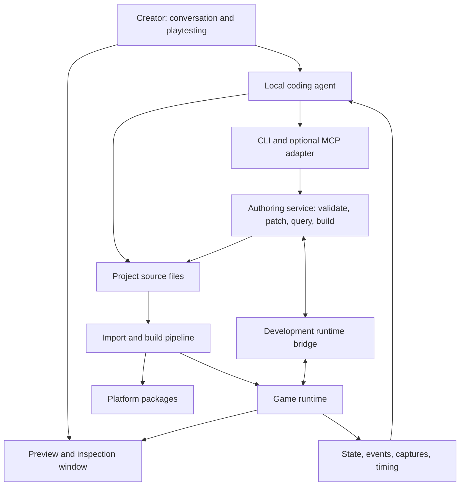

# Product and target architecture

Target design with a runnable Windows alpha. C++20 + Luau and a subset of the [selected stack](06-selected-stack.md) are integrated and exercised by native/headless, playthrough and preview checks. The [alpha contract](07-first-release.md) documents the command surface and validation limits. Broader operations, service guarantees, asset systems and capability tracks below remain future architecture unless explicitly identified as alpha behavior.

## The experience we are building

The human is the decision-making developer and primary gameplay playtester. AI agents are worker developers who implement that person's ideas and perform technical verification. Langmake should reduce the labor between an idea and a playable iteration while keeping creative direction, priorities and acceptance with the human. Meaningful milestones include actual human play and feedback, followed by the next authorized iteration; passing automated checks alone does not establish gameplay acceptance. The operational default is documented in the [agent workflow](08-agent-api.md#human-directed-development-and-playtesting).

A creator says: “Make a third-person exploration game for Windows. Give me a ruined courtyard, one character, a locked door, and a key. Let me try it.” The agent selects a template, authors the scene and behavior, validates references, runs a short scenario, and opens a playable preview. The creator points at the stairs and says, “Make these less steep and bring the camera closer.” The selection supplies an object ID and camera context so the agent can make a precise edit.

Conversation drives development through an external agent. Persistent files retain the result. Natural language is an input to that agent, not the executable specification or required input format of the engine. The engine accepts ordinary files and structured operations. Gameplay uses conventional code and data; no model call sits in the frame loop. Model connections, inference, and conversation management are outside the engine's scope.

## Minimal visual workspace

The first interface is a standalone game/inspection window controlled by the agent's existing chat environment. Do not build another chat application initially.

| Creator need | Proposed visual feature |
| --- | --- |
| See and try the result | Play, pause, restart, possess the player |
| Understand a scene | 2D pan/zoom; 3D orbit/fly; named camera bookmarks |
| Refer to a particular object | Click selection, stable ID, name and transform summary |
| See why something behaves incorrectly | Optional collision, navigation, bounds, and input overlays |
| Explain a change | Screenshot plus selection and camera context |
| Compare an iteration | Before/after captures and change summary |
| Recover from a bad edit | Restore a project checkpoint |

Dragging objects is optional later. If implemented, a visual edit must call the same authoring service as the CLI and produce the same file change. The viewport must not become a second source of truth. Headless simulation and graphical preview are different execution modes; a headless pass does not demonstrate rendering correctness.

## Architecture



The diagram describes the target architecture, including an import pipeline and optional services that the alpha does not yet supply. Authoring tools run on the developer's machine. Future shipping-only packages should contain the game runtime, behavior and cooked assets, excluding development endpoints. The current alpha is intentionally a development bundle with the CLI and live control bridge, JSON sources and Luau compiler/VM. It contains no Node.js, MCP server or model credentials.

The native C++ core owns scene validation, component metadata, simulation, asset conversion, and runtime queries. Reuse those operations in headless tools and the development bridge. A thin TypeScript adapter may supervise processes and expose MCP, but must not duplicate engine semantics or be required to run a packaged game.

Use explicit subsystems for the platform layer, renderer, world/ECS, scripting, assets, input, audio, physics, UI, navigation, and packaging. Give each observable state and registered property metadata. Keep third-party types behind adapters, with engine-owned stable IDs, property definitions, and errors at the public boundary. Qualify one rendering backend first; schedule native GPU interoperability for XR in the platform milestone.

## Files are durable, small, and inspectable

The alpha uses a compact layout: `project.json` contains scene entities, settings and camera data; `scripts/game.luau` contains game behavior. The engine's `schema` command and bundled examples describe the current fields. The following richer layout is a future design, not the current on-disk format:

```text
game/
  game.json                 # project identity, entry scene, target profiles
  engine.lock.json          # exact engine/tool/plugin versions and hashes
  intent/                   # creator-approved design and constraints
  scenes/                   # scene source and reusable prefabs
  scripts/                  # game behavior
  assets/source/            # meshes, textures, audio, fonts
  assets/catalog.json       # stable IDs, import recipes, provenance
  targets/                  # platform budgets and input/render profiles
  scenarios/                # reproducible gameplay checks
  .langmake/cache/          # generated, disposable imports and indexes
  .langmake/evidence/       # logs, screenshots, test results
  builds/                   # generated packages
```

The target data contract uses strict JSON plus [JSON Schema](https://json-schema.org/draft/2020-12): one scene or reusable object per file, schema version, stable identity, descriptive name, explicit units, references by ID, and small components. The alpha starts with one project file and explicit entity IDs; prefabs and the richer multi-file format are future work. Gameplay behavior lives in Luau source files. JSON has predictable parsers and diffs. A new custom language or compact text syntax should require evidence that it solves a measured problem.

Large meshes, images, and audio remain binary assets. Text-first authoring does not mean feeding vertices or image bytes into the model. The agent queries catalog metadata and previews. Declare coordinate conventions and convert at import: proposed defaults are meters, seconds, Y-up, right-handed 3D; 2D uses explicit pixel/world scaling. Each library adapter translates conventions at its boundary.

Separate asset IDs, authored object IDs, prefab-instance IDs, and temporary runtime handles. Instances combine their own identity with the prefab's local object identity. Cloning assigns new instance/object identities; renaming preserves existing identities. Define overrides explicitly so changing one instance cannot silently modify its template or every other instance.

## The agent interface

Every authoring operation should be available through the CLI with a stable JSON result and meaningful process exit code. MCP is an optional adapter over the same functions, not a prerequisite for editing files. Its [tool specification](https://modelcontextprotocol.io/specification/2025-11-25/server/tools) supplies structured inputs and outputs; we still have to implement game-specific semantics.

API coverage is a release requirement: no supported authoring feature may require a hidden dialog, mouse gesture, or undocumented editor state. Advanced behavior can be supplied through scripts or extensions when a convenience command is insufficient. Publish capability limits explicitly instead of forcing every game into a fixed set of natural-language recipes.

Proposed command families:

| Family | Representative operations |
| --- | --- |
| Discover | `capabilities`, `schema`, `help`, API examples for the installed version |
| Understand | `project summarize`, `scene query`, `object inspect`, `references find` |
| Change | `scene patch`, `asset import`, `behavior attach`, `checkpoint restore` |
| Verify | `validate`, `scenario run`, `input replay`, `capture`, `profile` |
| Iterate | `preview start`, `pause`, `step`, `reload`, `restart` |
| Ship | `target check`, `build`, `package`, `artifact inspect` |

These are future command families, not the alpha's exact syntax. Its current flat commands include `inspect`, `patch`, `simulate`, `preview`, `control`, `capture`, `checkpoint` and `restore`; consult [the alpha contract](07-first-release.md). A small operation set with useful batch requests is preferable to hundreds of tools in the model's context.

The target response contract includes an operation ID, success/failure status, relevant revision, located diagnostics, changed files and evidence paths. Job IDs with status/cancellation, filtering, pagination and summary/detail levels are future service features. The alpha returns structured JSON and uses process exit codes; do not infer these broader guarantees from that initial interface. Avoid returning an entire scene or raw console log when a narrow answer is available.

Example patch contract, illustrative only:

```json
{
  "operation": "scene.patch",
  "request_id": "change-0042",
  "scene": "courtyard",
  "expected_revision": "r17",
  "changes": [
    {"object": "stairs-entry", "property": "ramp_angle_degrees", "value": 18}
  ],
  "validate": true
}
```

Here `ramp_angle_degrees` belongs to a hypothetical parametric stairs prefab. The agent must discover properties; it cannot assume that arbitrary labels map to engine fields.

Prevalidate an entire batch, stage writes, check the expected revision, then commit the new source state. Base revisions on content hashes, detect external file changes, and invalidate pending operations when their inputs change. Reject stale edits with a conflict report. Store request IDs to make retries safe. Use a transaction journal and a revision commit point so cooperating readers see complete service-owned changes and interrupted writes can recover.

Rollback guarantees apply to service-owned transactions. Arbitrary shell/file edits cannot become atomic merely because the engine is watching the directory. Detect and validate those edits, preserve checkpoints, and report conflicts or invalid source. Never silently overwrite a direct edit. Source rollback does not reverse an already-running simulation: reset or restore a supported runtime snapshot explicitly.

Apply runtime changes at safe update boundaries. Data/material changes can often reload; script layout or physics changes may require scene restart. Report the required action. Promise fast iteration, not universal state-preserving hot reload.

Distinguish transient preview mutations from persistent authoring edits. Persist a preview property only through an explicit commit operation that maps it to its source object and prefab override. Ordinary runtime events, such as a character walking across a scene, must not rewrite authored transforms.

## Observation and verification

The agent needs both visual and semantic evidence: named-camera screenshots, stable object IDs, positions, velocities, collision events, animation states, inputs, and CPU/GPU timing. Track authored, imported, and loaded runtime revisions separately. Captures and queries identify the loaded revision, frame/tick, camera pose, engine version, target profile, seed, and any pending reload/error. An explicit readiness operation waits for the requested revision before tests or captures begin. A picture alone cannot prove a key was collected or a save survived restart.

Scenario tests use explicit inputs, seeds, fixed simulation steps, and assertions such as “player reaches the door,” “door stays locked without the key,” and “reloading the save preserves inventory.” Fixed steps improve reproducibility; they do not guarantee bit-identical physics across CPUs, engines, or platforms. Use tolerances where appropriate. Render comparisons are device/backend aware, and the human still evaluates feel, art direction, comfort, and fun.

Ship concise version-matched local API docs, task examples, and generated schemas. Errors should describe what failed and where, while suggesting only operations actually supported by the installed version. The agent can then repair a project without relying on memorized APIs.

## Full 2D and 3D: capability tracks

“Fully featured” is a direction requiring a checklist, not a first-release label.

| Area | Initial proof | Production growth |
| --- | --- | --- |
| 2D | Sprites, layers, orthographic camera, tiles, collision, UI | Tile tools/API, sprite animation, lights, particles, texture atlases, pixel scaling |
| 3D | Meshes, materials, lights, camera, collision, character movement | Skeletal animation/blending, shadows, navigation, LOD, instancing, particles, streaming |
| Shared gameplay | Input actions, prefabs, events, scene changes | Save migration, localization, accessibility, robust lifecycle and resource ownership |
| Audio | Music, effects, volume buses | Spatial sound, streaming, mixing and accessibility controls |
| UI | Text, buttons, HUD, gamepad focus | Layout, font shaping, multilingual text, touch and screen-size adaptation |
| Assets | PNG, glTF/GLB, WAV/OGG as supported by selected runtime | Compression, import recipes, incremental cooking, dependency tracking |
| Networking | Architectural separation of simulation and presentation | Dedicated servers, replication and recovery; rollback/netcode chosen by game needs |
| Delivery | Desktop build and smoke test | Platform services, device tests, signing and store packaging |

Do not model all 2D as a thin 3D shortcut: provide independent collision and camera semantics. Build one 2D and one 3D reference game early. Multiplayer, massive worlds, advanced terrain, and cinematic fidelity require later explicit scope; they are not implied by a working renderer.

## Asset and extension pipeline

Use [glTF/GLB](https://www.khronos.org/gltf/) for initial 3D exchange. Preserve original assets and deterministic import settings. Validate scale, orientation, materials, skeletons, and animation clips, then generate target-specific cached assets. A cache key includes source bytes, importer version, settings, and target profile. glTF is an asset interchange format, not our complete gameplay scene format.

Store each acquired asset's source URL, author, license, attribution, modification notes, and content hash. Free download does not establish permission to redistribute it. Sample games should start with primitives and clearly licensed assets. A proprietary generative-art service must never be required to build a game.

Extensions register their schemas, dependencies, capabilities, target support, and migrations. The first version should support a narrow documented extension seam rather than a public marketplace or arbitrary package installer.

## Local operation and boundaries

The tools must work with an external agent backed by either a local or an online model. This is a confirmed requirement. The engine does not choose, bundle, host, or call a model, and it does not need a model provider API key. A script or human using the same API must be able to perform the same operations. With dependencies cached, engine authoring commands should work offline; whether an external agent can reason offline is that agent's responsibility.

Keep future authoring services project-scoped, using local IPC or loopback with a session token, and exclude development endpoints from shipping-only players. The alpha's local file-based preview bridge is part of its development bundle. Serialize mutations so an agent and a visual inspector cannot silently overwrite each other. A project-scoped engine API cannot sandbox an agent with unrestricted shell access; the agent host must enforce any broader filesystem policy.

This project's bootstrap keeps dependency sources in `.deps/`, supported caches and temporary files in `.cache/`, and generated outputs in `build/` and `dist/`. It invokes existing tools without installing them or scanning external runtime directories. Installing SDKs or changing machine settings outside this directory requires separate authorization. Ordinary authorized scene edits and test runs should not introduce repetitive permission prompts.
